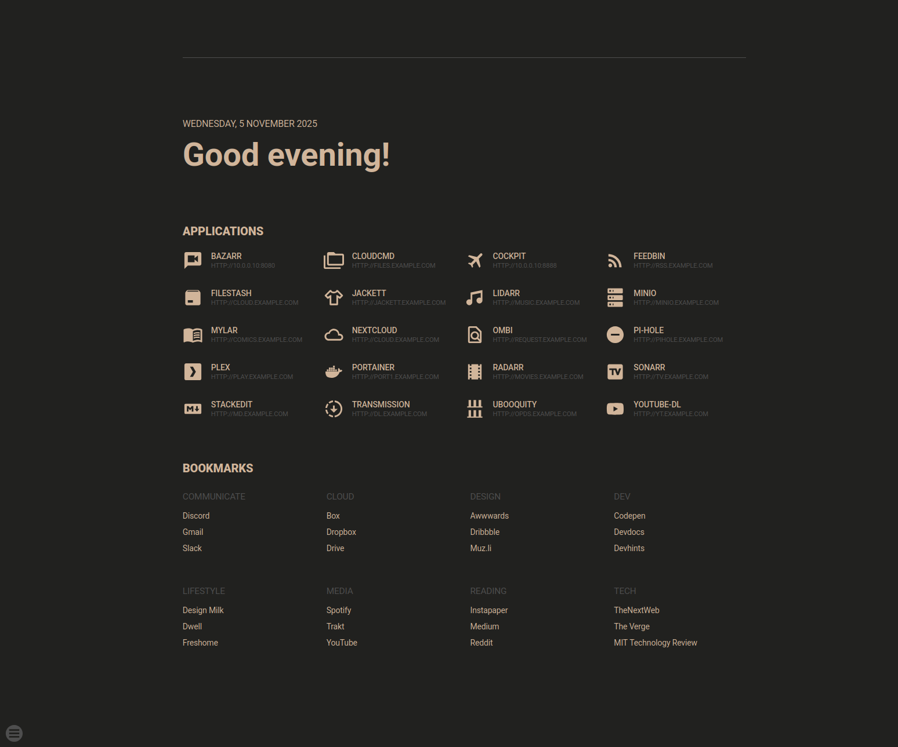

# Startpage

A clean, customizable browser startpage with theme support, application shortcuts, and bookmarks.



## Features

- Dynamic date and greeting display
- Application shortcuts with icons
- Bookmarks organized by categories
- Theme switcher with multiple themes
- Search functionality with multiple providers
- Responsive design

## Structure

```
├── index.php           # Main page
├── data.php            # Data loading and helper functions
├── admin.php           # Admin interface
├── apps.json           # Application data
├── links.json          # Bookmarks data
├── providers.json      # Search provider data
├── assets/
│   ├── css/
│   │   └── styles.css  # Styling
│   └── js/
│       ├── script.js   # Date and greeting functions
│       ├── themer.js   # Theme switching
│       └── search.js   # Search functionality
└── README.md
```

## Installation

1. Copy all files to your web server
2. Ensure PHP is installed and running
3. Access via your web server

## Configuration

Edit the JSON files to customize:
- **apps.json**: Add/modify application shortcuts
- **links.json**: Modify your bookmarks
- **providers.json**: Change search providers

## Requirements

- PHP 7.0 or higher
- Web server with PHP support (Apache, Nginx, etc.)

## Credits

Based on [SUI](https://github.com/jeroenpardon/sui) by [jeroenpardon](https://github.com/jeroenpardon)
